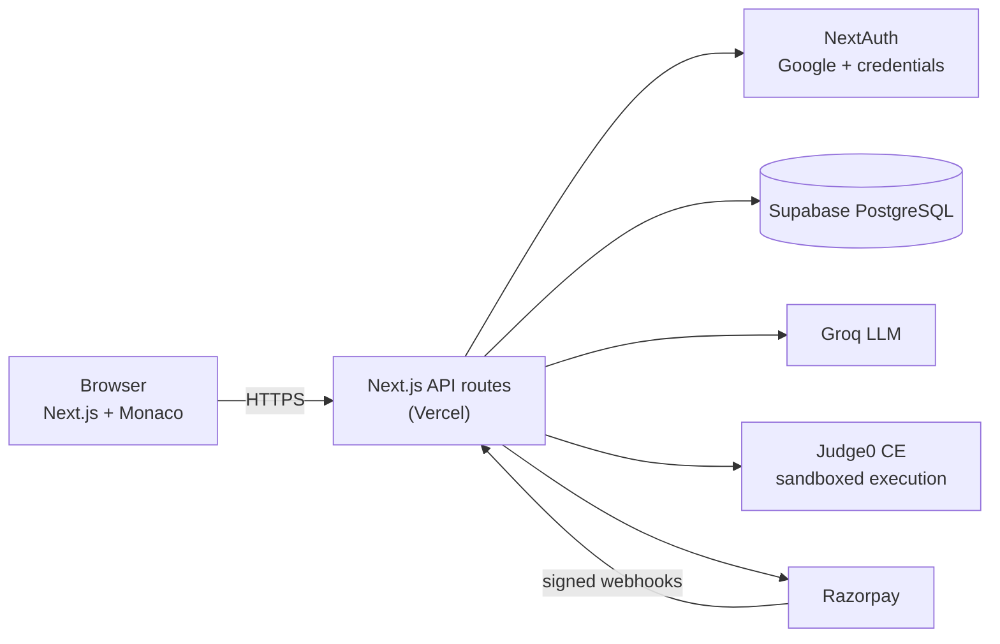

# TutorAI: AI-Powered DSA Coding Tutor

A LeetCode-style practice platform where an AI tutor guides your thinking instead of handing you the answer. Write code in the browser, run it against test cases in a sandbox, and ask the tutor for a hint, a logic check, a debugging nudge, or an optimisation idea.

**Live demo:** https://tutor-ai-stack.vercel.app

<!-- Add 2-3 screenshots here, e.g. docs/screenshots/compiler.png, then link them:
 -->

## Features

- **Problem workspace:** Monaco editor with 35 DSA problems across arrays, hashing, two pointers, sliding window, stacks, linked lists, trees, graphs, DP, backtracking and matrices.
- **Sandboxed code execution:** code runs on Judge0 CE. Python and JavaScript submissions are checked against per-problem test cases; Java and C++ can be run directly.
- **AI tutor with five modes:** Hint, Logic, Humanize, Debug and Optimize. The tutor is designed to guide thinking and never reveal the full solution.
- **Accounts:** Google OAuth and email/password sign-in (NextAuth), onboarding, and per-problem attempt tracking.
- **Credits and billing:** daily free credits gate AI usage; users can buy credit packs or subscribe via Razorpay.
- **Admin dashboard:** usage stats, waitlist management and live activity.

## Tech stack

| Layer | Tools |
|---|---|
| Frontend | Next.js (App Router), React, TypeScript/JSX, Tailwind CSS, Monaco Editor |
| Backend | Next.js API routes (Node.js runtime) |
| Database | Supabase (PostgreSQL) |
| Auth | NextAuth v4 (Google OAuth + credentials), bcrypt |
| AI | Groq API (`openai/gpt-oss-120b`) |
| Code execution | Judge0 CE |
| Payments | Razorpay (orders, signature verification, webhooks) |
| Hosting | Vercel |

## Architecture



**Running code** (`POST /api/execute`): the route wraps the user's code in a per-problem test harness (including helpers for linked-list and tree problems), submits it to Judge0, and returns stdout, compile errors, runtime errors and test results. If Judge0 is unreachable the route responds with a 503 instead of hanging (20 s request timeout).

**Asking the tutor** (`POST /api/chat`): the route authenticates the user, sanitises input, spends one credit, and builds the system prompt from an immutable foundation prompt, the selected mode, the problem context and the user's code. A lightweight guard screens explicit off-topic and jailbreak phrases.

**Paying** (`/api/payments/*`): `create-order` creates a Razorpay order with the user and item stored in the order notes. After checkout, `verify` validates the HMAC signature before updating credits or the subscription. `webhook` receives signed subscription events from Razorpay.

## Project structure

```
views/                 Next.js app, the code that runs in production
  app/api/             API routes: auth, chat, execute, payments, credits, attempts, admin
  app/compiler/        problem workspace (editor + AI tutor)
  app/dashboard/       problems, profile, billing, settings
  lib/                 credits, pricing, prompts, problem data, sanitising, origin checks
migrations/            SQL for the Supabase database
server.js, routes/,
controllers/, models/  legacy local Express server (not used in production)
```

## Getting started

**Prerequisites:** Node.js 20+, a Supabase project, a Groq API key, Google OAuth credentials, and Razorpay **test** keys.

```bash
git clone https://github.com/yukyk/TutorAIStack.git
cd TutorAIStack/views
npm install
cp .env.example .env.local    # Windows PowerShell: Copy-Item .env.example .env.local
# fill in the values in .env.local
npm run dev                   # http://localhost:3000
```

### Database setup

Run these in the Supabase SQL editor:

1. `views/lib/setupCredits.sql` creates `user_credits`, `credit_transactions` and `subscriptions`.
2. The `problem_attempts` and `users.onboarding_complete` statements in `migrations/schema.sql` (the Supabase versions are commented in that file). The `users` and `waitlist` tables are also defined there.
3. `migrations/002_payments.sql` creates the `payments` table and the payment fulfilment function.

### Environment variables

| Variable | Purpose |
|---|---|
| `NEXT_PUBLIC_SUPABASE_URL` | Supabase project URL |
| `SUPABASE_SERVICE_KEY` | Supabase service key (server-side only) |
| `NEXTAUTH_URL`, `NEXTAUTH_SECRET` | NextAuth base URL and signing secret |
| `GOOGLE_CLIENT_ID`, `GOOGLE_CLIENT_SECRET` | Google OAuth |
| `GROQ_API_KEY` | LLM access |
| `RAZORPAY_KEY_ID`, `RAZORPAY_KEY_SECRET` | Razorpay API (use `rzp_test_` keys locally) |
| `NEXT_PUBLIC_RAZORPAY_KEY_ID` | Razorpay key for the checkout widget |
| `RAZORPAY_WEBHOOK_SECRET` | Verifies Razorpay webhook signatures |
| `ADMIN_EMAIL`, `ADMIN_PASSWORD` | Admin dashboard login |

Never commit `.env.local`. Only `.env.example` is tracked.

### Quality checks

```bash
cd views
npx tsc --noEmit    # type-check
npx eslint .        # lint
npm run build       # production build
```

A GitHub Actions workflow (`.github/workflows/ci.yml`) runs the same checks on every push.

## Engineering decisions

- **Single deployable:** all API logic lives in Next.js route handlers so the app deploys to Vercel with no separate server.
- **Prompt layering:** an immutable foundation prompt plus a swappable mode prompt keeps tutor behaviour consistent and easy to tune.
- **Verify on the server:** payment signatures are checked with HMAC-SHA256 on the server, and secrets never reach the client.
- **Credits as a gate:** AI usage is metered per user, which keeps LLM cost bounded.

## Known limitations and roadmap

- Code execution uses the public Judge0 CE endpoint, which is shared and rate-limited; self-hosting is planned.
- The "never reveal the answer" behaviour is prompt-based. Planned: an output check plus an evaluation set of bypass attempts.
- Planned: automated tests (Vitest), Docker setup, Redis caching and rate limiting, and a queue for code execution.
- The legacy Express server in the repo root duplicates part of the API for local use and is due for removal.

## Author

**Yusuf Khambaty**: [GitHub](https://github.com/yukyk) · [LinkedIn](https://linkedin.com/in/yusufkhambaty)
